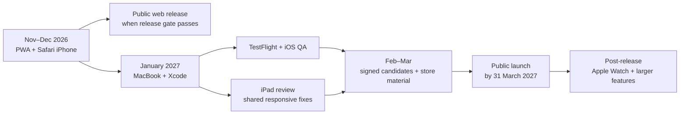

# Rave Route roadmap to public release

> Target: publicly publish Rave Route by **31 March 2027** at the latest.
>
> Current date: **7 November 2026**.

This is the active roadmap for the first public release. It replaces the older assumption that a rented cloud Mac would be used during the current development period. The installable web app is the active product and iPhone testing path until access to a personal MacBook is available around January 2027.

## TL;DR

**Now through December:** make the PWA genuinely dependable on iPhone Safari, fix the small UI issues discovered through real use, and publish the web app when it is ready.

**January through March:** use the MacBook for the iOS project, TestFlight, iPad review, signed release candidates, and store submission. Keep Apple Watch and larger product features out of the deadline path.

**By 31 March:** the PWA must be public. Native App Store and Play releases are the goal; if an Apple approval delay remains, do not hold back the stable web release.

## The release path at a glance

## Release definition

The release should provide:

- A stable installable PWA that works from Safari on iPhone.
- Public HTTPS hosting with SPA routing and service-worker caching.
- Festival creation, editing, deletion, persistence, images, line-ups, budgets, packing, settings, and catalogue browsing.
- Clear device/browser-local storage limitations.
- A reliable hosted catalogue with a bundled offline fallback.
- A signed Android release if the Play release path is ready.
- A tested native iPhone build if the January MacBook access is sufficient.
- Honest store/privacy/support material.

Apple Watch support, iPad-specific work, accounts, cloud sync, social features, music, payments, and advanced travel features are not required for this first public release. Apple Watch and iPad work cannot begin until the Mac/native phase and should not threaten the March deadline.

## Phase 1 — Web/PWA development and iPhone Safari testing

**7 November–31 December 2026**

### Main outcome

Make the web app polished, reliable, installable, and useful enough that it can be publicly hosted even if native Apple work takes longer than expected.

### November: establish the working baseline

- Deploy the corrected PWA build to Netlify.
- Test direct links such as `/home`, refresh behaviour, offline shell loading, and service-worker updates.
- Install the PWA on an iPhone from Safari.
- Test festival creation, editing, deletion, persistence, images, navigation, settings, and refresh.
- Record issues by category: release blocker, usability improvement, browser limitation, or native-only follow-up.
- Review the white fade at the top of the app and make the first small UI refinements.
- Keep the scope focused on useful, testable improvements.

### December: web release candidate

- Complete the Safari/PWA UX pass across small and large iPhone sizes.
- Verify local data survives browser restarts and normal PWA relaunches.
- Verify offline behaviour for previously loaded application resources and locally stored festival data.
- Test browser image selection and document any Capacitor-web limitations.
- Review accessibility, safe areas, keyboard behaviour, touch targets, contrast, loading states, and error messages.
- Refresh the Timetable.lol catalogue and verify hosted-first plus bundled fallback behaviour.
- Prepare support contact, privacy wording, known limitations, app screenshots, and basic release notes.
- Finalise onboarding copy and record video feedback from Safari testing; recreation of the videos belongs to the native phase.
- Publish the PWA publicly as an early web release if it meets the release gate. This reduces risk and gives the native phase a live product to improve rather than a single deadline-dependent launch.

### Phase 1 exit gate — 31 December 2026

- `npm run verify` passes.
- Netlify deployment succeeds from a clean GitHub commit.
- Direct-route navigation works on the deployed site.
- The PWA installs and launches from the iPhone Home Screen.
- Core planning journeys work online and after an offline relaunch.
- No known release-blocking data-loss, routing, install, or crash issue remains.
- The remaining work is clearly separated into web fixes, Android release work, and Mac/native work.

## Phase 2 — Mac, native Apple, and final public release

**January–31 March 2027**

### January: native foundation

- Obtain MacBook access and install the required Xcode, command-line tools, Node, and repository dependencies.
- Confirm Apple Developer Program and App Store Connect access.
- Generate or sync the Capacitor iOS project without removing the Android project or PWA path.
- Configure bundle ID, signing, deployment target, privacy descriptions, privacy manifest, icon, and splash assets.
- Run the app directly on the iPhone from Xcode.
- Check native photo selection, Filesystem image persistence, relaunch, safe areas, links, and offline fallback.
- Capture and fix iOS-only defects that can be corrected in the shared Angular/Ionic code.

### February: platform acceptance and release package

- Create an internal TestFlight build and test it on the iPhone.
- Complete the Android signed App Bundle and Play internal/closed testing path if Android is included in the first public release.
- Review iPad layout and orientation behaviour only after the iOS project is functioning. Fix high-value shared responsive issues; do not build an extensive iPad-only feature set before launch.
- Recreate or re-record the onboarding videos for the actual native app dimensions and playback behaviour.
- Prepare final screenshots, descriptions, icon/splash assets, privacy disclosures, Data Safety/App Privacy answers, support route, reviewer notes, and known limitations.
- Run upgrade, relaunch, offline, image retention, and fresh-install checks on signed candidates.

### March: hardening and publication

- Freeze feature scope by 1 March.
- Fix only release-blocking issues and high-confidence usability defects.
- Repeat the full acceptance matrix on the deployed PWA, Android candidate, and iPhone/TestFlight candidate.
- Confirm catalogue hosting, attribution, fallback, privacy wording, local-only storage messaging, and support contact.
- Submit the intended store builds and keep the PWA live as the fallback/public web experience.
- Publish no later than **31 March 2027**.
- Monitor the first 72 hours for crashes, routing failures, catalogue failures, image failures, and severe support issues.

## Apple Watch: after the first public release

Apple Watch is deliberately post-release. After the iOS foundation is stable, decide whether the first useful companion experience is a simple “next set” glance, reminders, or another focused feature. Define data access, offline behaviour, watch/iPhone communication, and support scope before creating a watch target.

## Full work inventory and priority order

This is the complete inventory of work currently deferred anywhere in the project documentation. Within each phase, work is ranked **least urgent to most urgent**: higher numbers should be protected first when time is limited.

### Phase 1 — Web/PWA work before MacBook access

**7 November–31 December 2026**

| Rank | Work item | Why it belongs here | Public-release position |
| ---: | --- | --- | --- |
| 1 | **AI, payments, and social features** | They have no agreed user problem, scope, privacy model, or operating plan. | Explicitly defer. |
| 2 | **Music playback / Spotify research** | Licensing, authentication, platform rules, and offline expectations make it poor deadline work. | Research only; do not build for March. |
| 3 | **Advanced travel planning** | Traveller origin, richer transport/accommodation provider links, optional flight suggestions, geocoding, maps, and navigation are useful later but not needed to plan a festival today. | Capture ideas; defer implementation. |
| 4 | **Accounts, cloud sync, cloud image storage, and shared calendars** | The existing Supabase and shared-calendar proposals require data migration, recovery, permissions, deletion, offline reconciliation, invites, realtime behaviour, group comparison, meeting sets, custom-event publishing, and external calendar export. | Design/reference only; do not build before March. |
| 5 | **Catalogue enhancements beyond reliability** | Automatic location enrichment, festival-style filters, extra import providers, bulk set-time paste/import, Must-see artist preferences, and set-time-change notifications all add value, but the current catalogue already supports the core journey. | Only take a small item if it directly fixes an observed user problem. |
| 6 | **Brand, theme, and first-run polish** | A fuller welcome flow, Light/Dark refinement, theme-aware icons, and a lighter/white logo treatment can improve perceived quality. | Do only the changes proven by Safari testing or needed for launch assets. |
| 7 | **Onboarding review** | Copy, flow, and the current demonstration videos need real-iPhone feedback. Video recreation waits for the native runtime. | Review and specify now; recreate later in Phase 2. |
| 8 | **Ongoing catalogue operations** | Timetable.lol refresh cadence, source/location/ticket/genre review, hosted JSON publication, and bundled fallback freshness protect the product’s usefulness. | Required operating work. |
| 9 | **Safari/PWA UX and accessibility pass** | Includes the white top fade, small layout improvements, safe areas, keyboard behaviour, touch targets, contrast, image selection, local persistence, routing, offline launch, and install/update behaviour. | Required before the web release. |
| 10 | **Public PWA release hardening** | Netlify deployment, HTTPS, direct-route fallback, service-worker updates, privacy/support copy, known limitations, screenshots, automated checks, and a real iPhone acceptance pass. | Highest Phase 1 priority; publish the PWA as soon as this gate passes. |

### Phase 2 — MacBook, native Apple, and store-release work

**January–31 March 2027**

| Rank | Work item | Why it belongs here | Public-release position |
| ---: | --- | --- | --- |
| 1 | **Apple Watch companion** | Requires a stable iOS foundation and a deliberate decision about the smallest useful watch job: next set, reminder, or another focused task. | Post-release; do not start before launch. |
| 2 | **Expanded iPad experience** | iPad portrait/landscape support should be assessed on native hardware, but a full tablet redesign can consume the release window. | Test and fix shared release-critical layouts only. |
| 3 | **Native theme-aware icon variants and branding exploration** | Platform-specific icon variants and a refined logo can improve polish once the native app exists. | Nice to have; finish only after core acceptance. |
| 4 | **Native onboarding-video recreation** | The videos should be rebuilt once their actual native dimensions, playback behaviour, and launch handoff can be tested. | Complete if onboarding is retained for launch; otherwise preserve the current working media. |
| 5 | **iPad acceptance pass** | Check safe areas, orientation, touch behaviour, standalone presentation, and responsive shared pages. | Required assessment; fixes are prioritised by user impact. |
| 6 | **Android signed release path** | Complete signing, internal/closed testing, upgrade tests, Play listing, Data Safety, and required tester period where applicable. | Required if Android is included in the March public release. |
| 7 | **Native iOS foundation** | Generate/sync the Capacitor iOS project, configure Xcode, signing, privacy text/manifest, app assets, photo/filesystem behaviour, and direct iPhone runs. | Required before any App Store release. |
| 8 | **TestFlight and native resilience** | Validate fresh install, upgrade, relaunch, offline fallback, image persistence, links, permissions, accessibility, and crash-free core journeys. | Required before App Store submission. |
| 9 | **Store and launch package** | Final screenshots, descriptions, categories, age ratings, privacy disclosures, support route, reviewer notes, signing backups, release notes, and go/no-go evidence. | Required for store publication. |
| 10 | **Release hardening and publication** | Freeze scope, fix only blockers, repeat acceptance on PWA and signed candidates, submit stores, then monitor for 72 hours. | Highest Phase 2 priority; complete by 31 March. |

### Phase 3 — After the first public release

This phase is also ranked least to most urgent so future work remains intentional rather than becoming one unbounded backlog.

| Rank | Work item | Analysis and prerequisite |
| ---: | --- | --- |
| 1 | **AI, payments, and social features** | No validated use case or operating model exists; decide the problem before selecting technology. |
| 2 | **Music playback / Spotify** | Proceed only after licensing, product value, authentication, and platform constraints are clear. |
| 3 | **Advanced travel and maps** | Build from observed demand: transport/accommodation enrichment, origin capture, flight shortcuts, geocoding, maps, and navigation. |
| 4 | **Catalogue and line-up extensions** | Prioritise by user demand: location enrichment, festival-style filters, bulk imports, extra providers, Must-see artists, and change notifications. |
| 5 | **Apple Watch** | Start with one companion job, backed by proven iOS data flow and a support plan. |
| 6 | **Accounts and cloud sync** | Use the [User accounts plan](user-accounts-plan.md) as a design reference. First solve ownership, authentication, migration, recovery, deletion, export, photo policy, conflict handling, and offline sync. |
| 7 | **Shared set-time calendars** | Follow accounts/sync. Then use the [Shared set-time calendars plan](shared-set-time-calendars-plan.md) to address membership, invitations, permissions, realtime updates, group comparison, meeting sets, custom-event publishing, and calendar export. |

### Reality check on the March ambition

The project can realistically complete the PWA release, native iOS foundation, TestFlight, iPad acceptance, and store-release preparation by 31 March if Phase 1 stays focused on quality and Phase 2 protects release work.

Completing every deferred feature—including backend accounts, sync, shared calendars, Apple Watch, advanced travel, music, social, payments, and AI—by that date would turn a three-phase product roadmap into a much larger multi-platform programme and would materially endanger the public launch. The right standard for March is a polished, useful, trustworthy local-first product; the ranked inventory ensures every idea has a visible home without pretending every idea is equally urgent.

## What is deliberately not on the critical path

- Accounts, cloud synchronisation, cloud image storage, shared calendars, payments, AI features, social features, music playback, maps, and advanced flight/travel suggestions.
- A complete iPad redesign before the first release.
- Apple Watch implementation before the iOS app exists.
- Rewriting the local-first data model before real user feedback proves it is necessary.

## Weekly working rhythm

1. Choose one small user-visible improvement or one release risk.
2. Test it in the browser and, when available, on the iPhone.
3. Run the relevant automated checks.
4. Record the result and any follow-up in `docs/development-log.md`.
5. Keep `main` deployable and avoid starting a new feature when a release blocker is open.

## Go/no-go criteria for 31 March

Release when the chosen public channels satisfy all of these:

- The deployed PWA loads, routes, installs, refreshes, and works offline within its documented limits.
- Core festival planning data persists and does not silently disappear during normal use.
- The catalogue and bundled fallback are verified.
- Store builds, if included, install and pass the core acceptance matrix.
- Privacy, support, permissions, and local-storage limitations are accurately documented.
- No known release-blocking crash, routing failure, signing failure, data-loss issue, or store-compliance issue remains.

If native store approval slips, publish the stable PWA by 31 March and treat native store publication as the next release milestone. This preserves the public deadline without rushing unverified Apple Watch, iPad, or native-only work.
